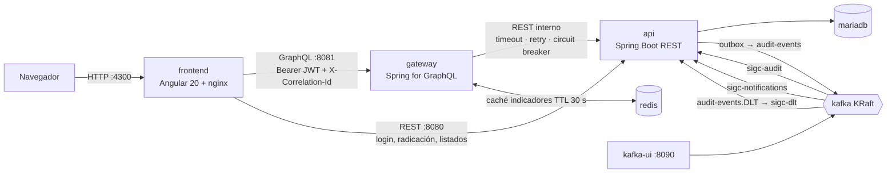

# SIGC — Sistema Inteligente de Gestión de PQR · Entrega final (v3.0.0)

Sistema para radicar, gestionar y auditar **peticiones, quejas y reclamos (PQR)** con una arquitectura distribuida: frontend Angular → **Gateway GraphQL** → **API REST** → MariaDB, con **Apache Kafka** para el procesamiento asíncrono (auditoría y notificaciones) y **Redis** como caché de indicadores.

| | |
|---|---|
| **Asignatura** | Programación Avanzada — Grupo 3, jornada día |
| **Docente** | Diego Fernando Vargas Ramírez |
| **Programa** | Ingeniería de Software — 9.º semestre |
| **Integrantes** | Santiago Murcia Cangrejo · Hallys Andrea Escobar Paloma |
| **Versión entregada** | `v3.0.0` (etiqueta git) |

## 1. Arquitectura



| Componente | Tecnología | Responsabilidad | Se comunica con |
|---|---|---|---|
| `frontend` | Angular 20, nginx | Interfaz del ciudadano y del administrador. El dashboard de administración lee sus indicadores del gateway | gateway (GraphQL), api (REST) |
| `gateway` | Java 21, Spring Boot 4.0.3, Spring for GraphQL, Resilience4j 2.2, Spring Data Redis | Punto de entrada GraphQL: valida el JWT, autoriza por rol, compone y adapta respuestas de la API, aplica timeout/retry/circuit breaker y cachea indicadores. **No tiene base de datos ni reglas de negocio** | api (HTTP), redis |
| `api` | Java 21, Spring Boot 4.0.3, Spring Security + JWT (jjwt 0.11.5), JPA, Spring Kafka | Reglas de negocio, persistencia, autenticación, documentos, motor de reglas legales, productor (outbox) y consumidores Kafka | mariadb, kafka |
| `db` | MariaDB 10.11 | Persistencia (esquema creado por JPA) | — |
| `kafka` + `kafka-init` | Apache Kafka 3.9.1 (KRaft) | Tópicos `audit-events` (3 particiones) y `audit-events.DLT` | api |
| `redis` | Redis 7.4 | Caché de indicadores de lectura frecuente y último valor conocido (respaldo si la API cae) | gateway |
| `kafka-ui` | kafbat kafka-ui | Inspección de tópicos, mensajes, headers y grupos de consumidores (herramienta) | kafka |

Detalle de componentes, flujos y decisiones: [docs/arquitectura.md](docs/arquitectura.md). Kafka: [docs/kafka.md](docs/kafka.md). Gateway: [gateway/README.md](gateway/README.md).

## 2. Requisitos

- Docker 24+ con Docker Compose v2 (probado con Docker 29.4 / Compose 5.1).
- Puertos libres: **4300** (frontend), **8081** (gateway), **8080** (API), **3307** (MariaDB), **9092** (Kafka), **8090** (Kafka UI). Se cambian en `.env`.
- Solo para desarrollo sin Docker: JDK 21, Maven 3.9 (o el wrapper `mvnw`), Node 22.
- Dependencias externas **opcionales**: SMTP de Gmail (`MAIL_ENABLED=true`) y API de Anthropic para el chatbot (`ANTHROPIC_API_KEY`). Sin ellas el sistema funciona: el correo queda en modo `SIMULATED` y el chatbot no responde.

## 3. Instalación y ejecución

```bash
cp .env.example .env              # valores de ejemplo para desarrollo (cámbielos en un despliegue real)
docker compose up --build -d      # primera vez: 5-10 min (descarga dependencias Maven y npm)
docker compose ps                 # todos "running"/"healthy"; kafka-init termina con "exited (0)"
```

Orden de arranque (lo garantiza `depends_on` + healthchecks): `db`, `kafka`, `redis` → `kafka-init` → `api` → `gateway` → `frontend`.

| Servicio | URL / puerto | Notas |
|---|---|---|
| Frontend | http://localhost:4300 | Inicie sesión con el administrador inicial |
| Gateway GraphQL | http://localhost:8081/graphql · GraphiQL: http://localhost:8081/graphiql | Salud: `/actuator/health` |
| API REST | http://localhost:8080 | Salud: `/actuator/health`. Contrato: [contracts/openapi.yaml](contracts/openapi.yaml) |
| Kafka UI | http://localhost:8090 | |
| MariaDB | `localhost:3307` | usuario/clave de `.env` |

**Usuario administrador inicial** (definido en `.env`): documento `1000000001`, clave `Admin.12345`. Los ciudadanos se registran en `POST /auth/register` (siempre rol CONSULTOR).

**Datos ficticios de prueba:** `bash scripts/demo-final.sh` crea un ciudadano y una PQR ficticios y recorre todo el flujo. La colección Postman está en [docs/API_Documental.postman_collection.json](docs/API_Documental.postman_collection.json) y el esquema SQL de referencia en [database/sigcapi.sql](database/sigcapi.sql) (el esquema real lo crea/actualiza JPA al arrancar; no hay migraciones manuales).

Detener: `docker compose down` (conserva datos) · `docker compose down -v` (borra volúmenes).

## 4. Variables de entorno

Todas están en [.env.example](.env.example) (sin secretos reales; `.env` no se versiona).

| Variable | Uso |
|---|---|
| `DB_NAME`, `DB_USER`, `DB_PASSWORD`, `DB_ROOT_PASSWORD`, `DB_PORT` | MariaDB (obligatorias) |
| `JWT_SECRET` | Clave HMAC compartida por API (firma) y gateway (validación). Mín. 32 caracteres (obligatoria) |
| `ADMIN_DOCUMENT`, `ADMIN_PASSWORD`, `ADMIN_EMAIL`, `ADMIN_NAME` | Administrador inicial |
| `CORS_ALLOWED_ORIGINS` | Orígenes permitidos en API y gateway (lista explícita, nunca `*`) |
| `API_CONNECT_TIMEOUT_MS`, `API_READ_TIMEOUT_MS` | Timeouts del gateway hacia la API |
| `KAFKA_*`, `API_PORT`, `GATEWAY_PORT`, `FRONTEND_PORT`, `KAFKA_UI_PORT` | Puertos y tópicos |
| `MAIL_ENABLED`, `EMAIL_USERNAME`, `EMAIL_PASSWORD` | Correo real (opcional) |
| `ANTHROPIC_API_KEY` | Chatbot (opcional) |

## 5. GraphQL (gateway)

Contrato: [contracts/schema.graphql](contracts/schema.graphql) (idéntico al que sirve el gateway; una prueba de contrato lo verifica).

| Operación | Tipo | Acceso | Servicio REST que la resuelve |
|---|---|---|---|
| `login(documento, password)` | mutation | pública | `POST /auth/login` |
| `me` | query | autenticado | claims del JWT |
| `misSolicitudes(page, size)` | query | autenticado | `GET /requests/my` |
| `radicarSolicitud(input)` | mutation | autenticado | `POST /requests/save` (multipart) → evento `REQUEST_CREATED` |
| `solicitudes(filtro, page, size)` | query | ADMIN | `GET /requests/all` |
| `solicitud(id) { historial }` | query | ADMIN | `GET /requests/findById/{id}` + `GET /requests/{id}/history` (composición) |
| `cambiarEstadoSolicitud(id, estado, observaciones)` | mutation | ADMIN | `PUT /requests/{id}/status` → evento `REQUEST_STATUS_CHANGED` |
| `resumenIndicadores` | query | ADMIN | `GET /events/summary` + conteos por estado; caché Redis 30 s |
| `volumenPorEstado` | query | ADMIN | `GET /requests/all?status=…`; caché Redis 30 s |

Ejemplo (GraphiQL o curl):

```bash
curl -s http://localhost:8081/graphql -H 'Content-Type: application/json' \
  -d '{"query":"mutation { login(documento: \"1000000001\", password: \"Admin.12345\") { token roles } }"}'
curl -s http://localhost:8081/graphql -H 'Content-Type: application/json' -H "Authorization: Bearer $TOKEN" \
  -d '{"query":"query { resumenIndicadores { totalSolicitudes solicitudesAbiertas solicitudesCerradas desactualizado } }"}'
```

Errores controlados: cada error GraphQL trae `extensions.codigo` (`UNAUTHORIZED`, `FORBIDDEN`, `BAD_REQUEST`, `NOT_FOUND`, `UNAVAILABLE`, `INTERNAL_ERROR`) y `extensions.correlationId`.

## 6. Seguridad

- **Autenticación:** la API valida credenciales (BCrypt, bloqueo tras 5 intentos) y emite un **JWT HS256** (24 h) con `sub` = documento y claim `roles`. No lleva datos personales.
- **Autorización:** el gateway valida firma y vigencia del token y aplica `@PreAuthorize` por operación (tabla anterior). La API **vuelve a validar** el token y el rol en cada endpoint (no se asume que una llamada interna sea legítima).
- **Propagación mínima:** el gateway solo reenvía `Authorization` y `X-Correlation-Id`.
- **CORS** explícito en API y gateway (`CORS_ALLOWED_ORIGINS`); CORS no reemplaza la autenticación.
- **Secretos** solo en variables de entorno; `.env` está en `.gitignore`. Los logs no registran tokens ni contraseñas.

## 7. Observabilidad

- **Correlation ID:** el cliente envía `X-Correlation-Id` (o el gateway lo genera) → gateway → API (`CorrelationIdFilter`) → `outbox_events.correlation_id` → header Kafka `x-correlation-id` → consumidores. Cada línea de log incluye `[correlationId=… eventId=… requestId=…]`.
- **Logs con prefijo:** `[GATEWAY]`, `[API-CLIENT]`, `[RESILIENCIA]`, `[OUTBOX]`, `[KAFKA-PRODUCER]`, `[KAFKA-CONSUMER:<grupo>]`, `[AUDITORIA]`, `[NOTIFICACIONES]`, `[KAFKA-DLT]`.

  ```bash
  docker compose logs -f gateway api | grep -E "correlationId=<id>"
  ```
- **Health y métricas (Actuator):** `/actuator/health` (público) en API y gateway; `/actuator/metrics` (ADMIN en la API).
- **Flujo de eventos:** `GET /events/summary`, `/events/outbox`, `/events/processed`, `/events/notifications`, `/events/dead-letters` (ADMIN).

## 8. Resiliencia

| Mecanismo | Dónde | Configuración | Riesgo que cubre |
|---|---|---|---|
| Timeout | gateway → API | conexión 2 s, lectura 5 s | API lenta que bloquea hilos del gateway |
| Retry | gateway → API, **solo GET** | 3 intentos, backoff 300 ms ×2, solo IO/timeout/5xx | Fallos transitorios; nunca en mutations (no idempotentes) |
| Circuit breaker | gateway → API | ventana 10, mín. 5 llamadas, 50 % fallos, abierto 15 s, 3 en half-open | Evitar insistir sobre una API caída; falla rápido con `UNAVAILABLE` |
| Respaldo Redis | `resumenIndicadores` | último valor conocido, `desactualizado: true` | Dashboard útil aunque la API no responda |
| Outbox + reintentos + DLT | API ↔ Kafka | ver [docs/kafka.md](docs/kafka.md) | Kafka caído, mensajes inválidos, duplicados (idempotencia) |

## 9. Pruebas

```bash
cd api.documental && ./mvnw test      # unitarias, integración (H2 + Kafka embebido), seguridad
cd gateway && ./mvnw test             # resolvers, seguridad GraphQL, resiliencia, contratos
bash scripts/demo-final.sh            # prueba de extremo a extremo contra docker compose (evidencias/final/)
```

Matriz de pruebas y evidencias: [docs/pruebas.md](docs/pruebas.md). Evidencias de la Entrega 2 (Kafka: idempotencia, DLT, reintentos) en [evidencias/salidas/](evidencias/salidas/).

## 10. Documentación

| Documento | Ruta |
|---|---|
| Arquitectura, responsabilidades y comunicación | [docs/arquitectura.md](docs/arquitectura.md) |
| Manual técnico y de uso | [docs/manual-tecnico.md](docs/manual-tecnico.md) |
| API REST (OpenAPI) / GraphQL / eventos (AsyncAPI) | [contracts/](contracts/) |
| Kafka (tópicos, eventos, idempotencia, errores) | [docs/kafka.md](docs/kafka.md) |
| Modelo de datos | [docs/modelo-datos.md](docs/modelo-datos.md) |
| Pruebas y evidencias | [docs/pruebas.md](docs/pruebas.md), [evidencias/](evidencias/) |
| Informe final y evidencias (PDF) | [entrega/](entrega/) |

## 11. Estado y limitaciones

| Estado | Funcionalidad |
|---|---|
| **Implementado** | API REST (auth JWT, PQR, documentos, usuarios, reglas, sesiones); Kafka con outbox, 3 consumidores, idempotencia, reintentos y DLT; gateway GraphQL con queries/mutations, seguridad, CORS, manejo de errores, timeout/retry/circuit breaker y caché Redis; correlation ID de extremo a extremo; Docker Compose completo; pruebas automatizadas |
| **Parcial** | Frontend: el dashboard de administración usa el gateway (indicadores); las demás pantallas siguen consumiendo la API REST directamente. Métricas: Actuator sin Prometheus/Grafana. Trazas: correlation ID sin OpenTelemetry. Correo en modo simulado por defecto |
| **Pendiente** | `GET /documents/my`; SSE/WebSocket (no se implementaron: el caso de uso no exige tiempo real, ver docs/arquitectura.md); despliegue en la nube |

En arranque en frío la primera radicación vía gateway puede superar el timeout de 5 s: el cliente recibe `UNAVAILABLE` aunque la PQR se crea (ver [docs/pruebas.md](docs/pruebas.md), hallazgo E25); se puede ampliar con `API_READ_TIMEOUT_MS`. Limitaciones: un solo broker Kafka (RF = 1); el relay del outbox supone una sola instancia de la API; Redis sin persistencia (solo caché); la primera construcción requiere Internet para descargar dependencias e imágenes.
