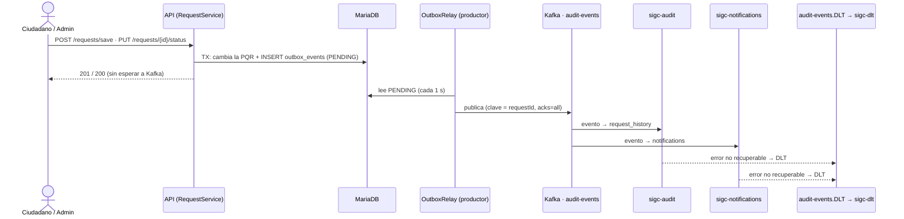

# SIGC — Entrega 2 (Segundo periodo): Kafka e integración orientada a eventos

Sistema Inteligente de Gestión de PQR (peticiones, quejas y reclamos).

**Equipo 4 · Grupo 3** — Santiago Murcia Cangrejo · Hallys Andrea Escobar Paloma

Esta entrega parte de la API REST de la Entrega 1 (Spring Boot 4 / Java 21, MariaDB, autenticación JWT, carga de documentos, filtros, paginación, validaciones y manejo centralizado de errores) y le integra **Apache Kafka** para procesar de forma asíncrona los efectos de cada cambio en una PQR: **auditar** el cambio y **notificar** al ciudadano.

## Contenido del ZIP

| Ruta | Descripción |
|---|---|
| `api.documental/` | API Spring Boot (código, pruebas y `Dockerfile`). La mensajería está en `src/main/java/com/backend/sigcapi/messaging/` |
| `Front-Angular-ProyectoAula8voSemestre-main/` | Frontend Angular del sistema |
| `docker-compose.yml` | MariaDB + Kafka (KRaft) + creación de tópicos + Kafka UI + API |
| `scripts/demo-kafka.sh` | Ejecuta el flujo completo contra el Compose y guarda las salidas en `evidencias/salidas/` |
| `docs/kafka.md` | Diseño de tópicos, eventos, productor, consumidores, idempotencia y errores (lo implementado) |
| `contracts/asyncapi.yaml`, `contracts/events/request-event.schema.json` | Contrato formal de los eventos |
| `contracts/openapi.yaml` | Contrato REST |
| `evidencias/EVIDENCIA_DE_FUNCIONAMIENTO.pdf` | PDF con las evidencias del flujo integrado |

## ¿Qué responsabilidad tiene Kafka?

En la Entrega 1 el cambio de estado de una PQR escribía el historial y enviaba el correo **dentro de la petición HTTP**: si el correo fallaba o tardaba, la respuesta se demoraba o fallaba. Ahora el servicio solo confirma el cambio y emite un evento; Kafka lo entrega a consumidores independientes:

| Evento | Consumidor | Efecto verificable |
|---|---|---|
| `REQUEST_CREATED` / `REQUEST_STATUS_CHANGED` | `sigc-audit` | Fila en `request_history` |
| `REQUEST_CREATED` / `REQUEST_STATUS_CHANGED` | `sigc-notifications` | Fila en `notifications` y `requests.mail_status = true` |
| Mensajes no procesables | `sigc-dlt` | Fila en `failed_events` |



## Ejecución

Requisitos: Docker con Docker Compose.

1. Copie `.env.example` a `.env`. Los valores por defecto sirven para desarrollo; cambie las claves antes de un despliegue real. Las variables `ADMIN_DOCUMENT`, `ADMIN_PASSWORD` y `ADMIN_EMAIL` crean el **administrador inicial** al arrancar (ver *Roles y registro*).
2. Levante todo desde la raíz:

   ```bash
   docker compose up --build -d
   ```

3. Servicios disponibles:

   | Servicio | Contenedor | Acceso |
   |---|---|---|
   | API | `sigc-api` | http://localhost:8080 |
   | MariaDB | `sigc-db` | `localhost:3307` |
   | Kafka (broker KRaft, sin ZooKeeper) | `sigc-kafka` | `localhost:9092` desde el equipo; `kafka:29092` entre contenedores |
   | Creación de tópicos (un solo uso) | `sigc-kafka-init` | termina al crear `audit-events` y `audit-events.DLT` |
   | Kafka UI | `sigc-kafka-ui` | http://localhost:8090 |

El esquema de la base de datos se crea o actualiza automáticamente mediante JPA. Los adjuntos se conservan en el volumen `documents_data`, los datos de MariaDB en `mysql_data` y los de Kafka en `kafka_data`.

Para desarrollo sin Docker, configure `SPRING_DATASOURCE_*`, `JWT_SECRET`, `STORAGE_PATH` y `KAFKA_BOOTSTRAP_SERVERS`, y ejecute desde `api.documental`:

```bash
bash mvnw spring-boot:run
```

## Demostración del flujo con Kafka

Con los servicios arriba:

```bash
bash scripts/demo-kafka.sh
```

El script recorre, en orden: servicios y tópicos → login del administrador → **radicación** de una PQR (productor, `REQUEST_CREATED`) → **cambio de estado** a `CERRADO` (productor, `REQUEST_STATUS_CHANGED`) → eventos del outbox con partición y offset → mensajes dentro del tópico → historial (consumidor `sigc-audit`) → notificaciones (consumidor `sigc-notifications`) → grupos de consumidores y lag → **reenvío de un evento duplicado** (idempotencia) → **mensajes inválidos** que terminan en el DLT → resumen y logs. Cada salida queda guardada en `evidencias/salidas/NN_*.txt`.

Las evidencias de cada paso están reunidas en `EVIDENCIA_DE_FUNCIONAMIENTO.pdf`.

## Tópicos y eventos

| Tópico | Particiones | Retención | Clave | Propósito |
|---|---|---|---|---|
| `audit-events` | 3 | 7 días | `requestId` | Eventos de dominio del ciclo de vida de las PQR (el orden por PQR se conserva porque comparten partición) |
| `audit-events.DLT` | 3 | 30 días | la del mensaje original | Mensajes que no pudieron procesarse, con la causa en los headers |

Los tópicos se crean de forma explícita (`kafka-init` y los beans `NewTopic`); la autocreación está desactivada.

| `eventType` | Cuándo se emite | `estadoAnterior` → `estadoNuevo` |
|---|---|---|
| `REQUEST_CREATED` | `POST /requests/save` confirmado | `null` → `CREADO` |
| `REQUEST_STATUS_CHANGED` | `PUT /requests/{id}/status` confirmado | estado previo → estado nuevo |

Ejemplo de evento:

```json
{
  "eventId": "8a3f4f0e-5c1b-4b7e-9d0a-2f6c1e7b9a41",
  "eventType": "REQUEST_STATUS_CHANGED",
  "eventVersion": 1,
  "source": "sigcapi.requests",
  "timestamp": "2026-10-05T19:32:00.512Z",
  "requestId": 1024,
  "tipoSolicitud": "QUEJA",
  "estadoAnterior": "CREADO",
  "estadoNuevo": "CERRADO",
  "actor": "1000000001",
  "actorId": 1,
  "observaciones": "Respuesta de fondo enviada"
}
```

Headers Kafka: `x-event-id`, `x-event-type`, `x-event-version`, `x-source` y `x-simulated` (solo simulador). Por la Ley 1581 de 2012 el evento **no** contiene datos personales del ciudadano. Detalle completo en [docs/kafka.md](docs/kafka.md) y [contracts/asyncapi.yaml](contracts/asyncapi.yaml).

## Productor, consumidores, idempotencia y errores

- **Productor (Transactional Outbox):** el evento se guarda en `outbox_events` en la **misma transacción** que el cambio de la PQR; el `OutboxRelay` lo publica en Kafka (`acks=all`, productor idempotente) y registra partición y offset. Si Kafka no está disponible, el evento queda pendiente y se publica al volver; si agota 10 intentos pasa a `FAILED` y se reintenta con `POST /events/outbox/{id}/retry`.
- **Consumidores:** `sigc-audit`, `sigc-notifications` y `sigc-dlt`. Los dos primeros reciben todos los eventos (fan-out) y avanzan de forma independiente.
- **Idempotencia:** `processed_events` registra `(event_id, consumer)` con restricción única, y `request_history.event_id` y `notifications.event_id` también son únicos. El efecto de negocio y la marca se guardan en la misma transacción, por lo que un evento repetido se ignora (`Evento duplicado ignorado`).
- **Errores:**

  | Tipo | Ejemplo | Tratamiento |
  |---|---|---|
  | Contrato inválido | JSON mal formado, falta `requestId` | Sin reintentos → DLT |
  | Negocio permanente | La PQR o el actor no existen | Sin reintentos → DLT |
  | Transitorio | BD o SMTP no disponibles | Reintentos con backoff 1 s → 2 s → 4 s; si persiste → DLT |

- **Logs:** cada línea incluye `[eventId=… requestId=…]`; prefijos `[OUTBOX]`, `[KAFKA-PRODUCER]`, `[KAFKA-CONSUMER:<grupo>]`, `[AUDITORIA]`, `[NOTIFICACIONES]`, `[KAFKA-RETRY]`, `[KAFKA-DLT]` y `[SIMULADOR]`.

  ```bash
  docker compose logs -f api | grep -E "OUTBOX|KAFKA|AUDITORIA|NOTIFICACION|SIMULADOR"
  ```

- **Notificaciones:** con `MAIL_ENABLED=false` (por defecto) el correo se construye y se registra con estado `SIMULATED` sin enviarse; con `MAIL_ENABLED=true` y credenciales SMTP se envía (`SENT`).

## Endpoints de observabilidad y simulación (solo ADMIN)

| Endpoint | Para qué |
|---|---|
| `GET /events/summary` | Resumen: outbox por estado, eventos procesados por consumidor, historial, notificaciones y mensajes en el DLT |
| `GET /events/outbox` | Eventos del productor (filtros `status`, `requestId`) con partición y offset |
| `POST /events/outbox/{id}/retry` | Reencola un evento `FAILED` |
| `GET /events/processed` | Eventos procesados por los consumidores (filtro `consumer`) |
| `GET /events/notifications` | Notificaciones generadas por eventos (filtro `requestId`) |
| `GET /events/dead-letters` | Mensajes recibidos en el Dead Letter Topic |
| `POST /events/simulate/duplicate/{eventId}` | Reenvía un evento ya publicado (prueba de idempotencia) |
| `POST /events/simulate/invalid-payload` | Publica un JSON mal formado (va al DLT) |
| `POST /events/simulate/contract-violation` | Publica un evento que incumple el contrato (va al DLT) |
| `POST /events/simulate/unknown-request` | Publica un evento de una PQR inexistente (va al DLT) |

Además, `GET /requests/{id}/history` devuelve el historial escrito por el consumidor de auditoría.

## Pruebas

Se usa el perfil `test` con H2 en memoria; **no requieren MariaDB ni Docker** (la prueba de integración con Kafka usa un broker embebido).

```bash
cd api.documental
bash mvnw test
```

Prueba solo del flujo de Kafka:

```bash
bash mvnw test -Dtest=KafkaEventFlowIntegrationTest
```

- **Integración con Kafka real embebido** (`KafkaEventFlowIntegrationTest`): API → outbox → relay → `audit-events` → consumidores → resultado en BD; idempotencia ante un duplicado; desvío al DLT de tres mensajes inválidos; y que el flujo normal continúa después de los mensajes defectuosos.
- **Mensajería (unitarias):**

  | Clase | Qué verifica |
  |---|---|
  | `EventCodecTest` | Serialización y validación del contrato del evento |
  | `OutboxRequestEventPublisherTest` | Registro en el outbox de `REQUEST_CREATED` y `REQUEST_STATUS_CHANGED` (PENDING, clave = `requestId`, `eventId` único) |
  | `OutboxRelayTest` | Publicación con partición/offset, el lote se detiene si Kafka falla (orden), paso a `FAILED` y reencolado |
  | `AuditEventProcessorTest` | Historial, idempotencia y errores no reintentables |
  | `NotificationProcessorTest` | Reglas de notificación (CERRADO, FALTA_DOCUMENTACION, reapertura omitida), acuse de radicación, duplicado sin segundo correo y fallo SMTP |
  | `EventConsumersTest` | Entrega al procesador, JSON inválido (`InvalidEventException`), duplicado concurrente por unicidad y persistencia en `failed_events` desde el DLT |

- **API REST** (`ApiIntegrationTests`, `SigcapiApplicationTests`): registro (201 / 400), login (200 / 401), rutas protegidas (401 / 403), paginación, recurso inexistente (404) y validación de la radicación (400).
- **Unitarias de la API** (JUnit 5 + Mockito): `RequestServiceImplTest`, `UserServiceImplTest`, `DocumentServiceImplTest`, `ExpertEngineServiceImplTest`, `RuleServiceImplTest`, `OperatorTest`, `JwtServiceTest`, `DtoValidationTest` y `GlobalExceptionHandlerTest`.

## Roles y registro

- `POST /auth/register` es público y **siempre crea un usuario CONSULTOR**; el campo `admin` (si se envía) se ignora.
- El primer administrador se crea al arrancar con `ADMIN_DOCUMENT`, `ADMIN_PASSWORD` (mín. 8 caracteres con mayúscula, minúscula y dígito) y `ADMIN_EMAIL`. Si no se definen, no se crea ninguno. Si el documento ya existe, no se modifica.
- Los demás administradores los crea un ADMIN con `POST /admin/users/save`.

## Endpoints principales de la API

`POST /auth/register`, `POST /auth/login`, `POST /requests/save`, `GET /requests/my`, `GET /requests/all`, `PUT /requests/{id}/status`, `GET /requests/{id}/history`, `GET /documents/all`, y la administración de usuarios, reglas, estándares y sesiones.

Las rutas protegidas requieren `Authorization: Bearer <token>`. Las listas administrativas aceptan filtros y paginación (`page`, `size`; además de fechas, estado o tipo según el recurso). Contrato REST: [contracts/openapi.yaml](contracts/openapi.yaml).

### Códigos HTTP

| Código | Cuándo |
|---|---|
| 200 / 201 / 202 / 204 | Consulta o actualización exitosa / creación / evento simulado aceptado / eliminación |
| 400 | Validación de campos (detalle por campo en `data`), JSON mal formado, parámetro o archivo faltante, regla de negocio |
| 401 | Sin token, token inválido o expirado, o credenciales incorrectas en el login |
| 403 | Rol insuficiente (se requiere ADMIN) o usuario bloqueado temporalmente |
| 404 | Recurso o ruta inexistente |
| 405 / 409 / 413 | Método no permitido / recurso duplicado / archivo demasiado grande |
| 500 | Error inesperado (el detalle queda en el log, no se expone al cliente) |

Los errores siguen el formato `{ "exito": false, "mensaje": "...", "data": { ... } }`. La paginación ajusta `page` a ≥ 0 y `size` al rango 1–100.

## Limitaciones conocidas

- Un solo broker con factor de replicación 1 (entorno de desarrollo). En producción: 3 brokers, `replication.factor=3` y `min.insync.replicas=2`.
- El relay del outbox supone una sola instancia de la API; con varias réplicas habría que usar `SELECT … FOR UPDATE SKIP LOCKED` o CDC (Debezium).
- El correo se entrega *al menos una vez*: en el peor caso (fallo justo después de enviar) podría llegar duplicado.
