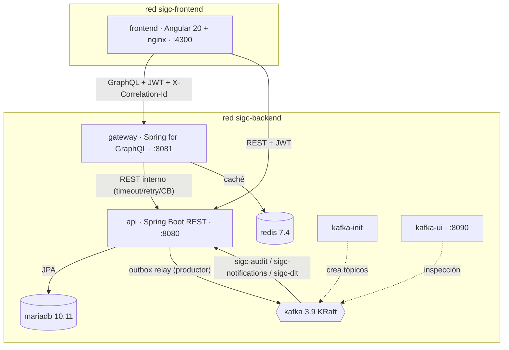
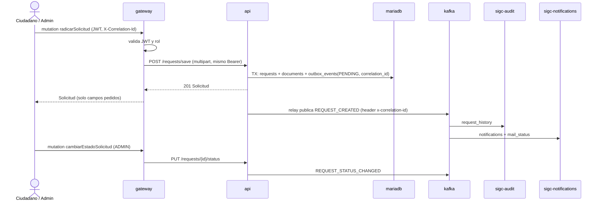

# Arquitectura del SIGC — Entrega final (v3.0.0)

## 1. Vista de componentes

`api` y `gateway` pertenecen a ambas redes; `frontend` solo a `sigc-frontend`; `db`, `kafka`, `redis` solo a `sigc-backend` (Redis no se publica al anfitrión).

## 2. Responsabilidades

| Componente | Hace | No hace |
|---|---|---|
| **frontend** | Formularios de radicación, consulta y gestión; dashboard de administración (indicadores vía GraphQL) | No aplica reglas de seguridad por sí solo: ocultar una opción no reemplaza la autorización del servidor |
| **gateway** | Punto de entrada GraphQL; valida JWT (firma y vigencia); autoriza por rol con `@PreAuthorize`; compone (`solicitud` + `historial`, `resumenIndicadores`); adapta nombres de campos al cliente; resiliencia; caché de indicadores | No tiene base de datos, no duplica reglas de negocio, no publica eventos |
| **api** | Reglas de negocio (radicación, motor de reglas Ley 1437/1581, cambios de estado), persistencia, autenticación, emisión del JWT, outbox y consumidores Kafka | No conoce el gateway: vuelve a validar token y rol en cada llamada |
| **kafka** | Almacena y distribuye `REQUEST_CREATED` y `REQUEST_STATUS_CHANGED` (clave `requestId`, 3 particiones) y el DLT | — |
| **redis** | Caché de lectura frecuente (TTL 30 s) y último valor conocido de indicadores | No es fuente de verdad: sin persistencia |
| **mariadb** | Fuente de verdad | — |

## 3. Comunicación

| Origen → destino | Protocolo | Autenticación | Datos propagados |
|---|---|---|---|
| navegador → frontend | HTTP | — | — |
| frontend → gateway | HTTP POST `/graphql` | `Authorization: Bearer <JWT>` | `X-Correlation-Id` |
| frontend → api | HTTP REST | `Authorization: Bearer <JWT>` | — |
| gateway → api | HTTP REST (red interna `http://api:8080`) | reenvía el mismo Bearer | solo `Authorization` y `X-Correlation-Id` |
| gateway → redis | RESP (red interna) | — | indicadores agregados (sin datos personales) |
| api → kafka | Kafka (`kafka:29092`) | PLAINTEXT (red interna) | evento sin datos personales + headers `x-event-id`, `x-event-type`, `x-correlation-id` |

## 4. Flujos principales

### 4.1 Radicar y gestionar una PQR (escritura)

### 4.2 Consultar (lectura compuesta)

`query solicitud(id) { estado historial { … } }` → el gateway llama `GET /requests/findById/{id}` y, solo si el cliente pidió `historial`, `GET /requests/{id}/history`; combina ambas respuestas y el cliente recibe solo los campos solicitados.

### 4.3 Indicadores (lectura frecuente con caché)

`resumenIndicadores` → Redis (hit: responde sin tocar la API) → si no, `GET /events/summary` + conteos por estado → guarda en Redis (TTL 30 s) y como "último valor conocido". Si la API no responde o el circuit breaker está abierto, devuelve el último valor con `desactualizado: true`.

## 5. Decisiones arquitectónicas (Semanas 11–15)

| Decisión | Alternativa | Justificación |
|---|---|---|
| Gateway GraphQL como microservicio separado, sin datasource | Agregar GraphQL dentro de la API | Separa la interfaz orientada al cliente de las operaciones de dominio; evita duplicar lógica (REST conserva las reglas) |
| JWT validado en gateway **y** en API | Confiar en el gateway | "No asumir que toda llamada interna es legítima" (defensa en profundidad) |
| Claim `roles` en el JWT | Consultar el rol a la API en cada operación | El gateway autoriza sin llamada extra; el rol no es dato sensible |
| Retry solo en GET | Retry en todas las llamadas | Las mutations no son idempotentes (radicar dos veces crearía dos PQR) |
| Circuit breaker con 4xx excluidos | Contar todo error | Un 404/403 es respuesta válida de una API sana |
| Redis para indicadores | Sin caché / caché en memoria | Consulta de lectura frecuente y costosa (varias llamadas); Redis permite compartir la caché si hay varias réplicas del gateway y conservar el último valor conocido |
| **No** SSE/WebSocket | SSE para notificar cambios de estado | El caso de uso (gestión de PQR con plazos en días) no exige tiempo real; agregaría gestión de conexiones sin beneficio real |
| Correlation ID propagado hasta Kafka | Solo logs por servicio | Permite seguir una operación gateway → API → productor → consumidores |
| Outbox transaccional (Entrega 2) | Publicar directo tras el commit | No se pierden eventos si Kafka está caído |

## 6. Seguridad por operación

| Operación | Pública | Autenticado | ADMIN |
|---|:-:|:-:|:-:|
| `login`, `POST /auth/**`, `/actuator/health` | ✔ | | |
| `me`, `misSolicitudes`, `radicarSolicitud`, `GET /requests/my`, `POST /requests/save` | | ✔ | |
| `solicitudes`, `solicitud`, `cambiarEstadoSolicitud`, `resumenIndicadores`, `volumenPorEstado`, `/events/**`, `/admin/**` | | | ✔ |
