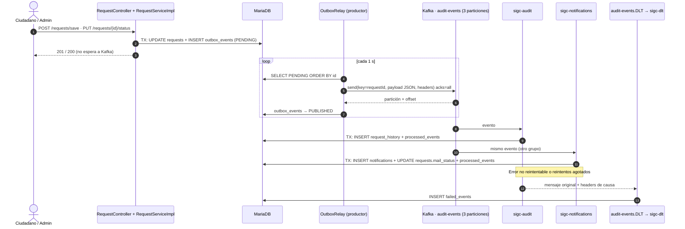

# Kafka en SIGC — tópicos, productores, consumidores y eventos (implementado)

> Entrega 2 · Segundo periodo · Este documento describe **lo que está implementado** en
> `api.documental/src/main/java/com/backend/sigcapi/messaging/`. El contrato formal está en
> [`contracts/asyncapi.yaml`](../contracts/asyncapi.yaml) y
> [`contracts/events/request-event.schema.json`](../contracts/events/request-event.schema.json).

## 1. Responsabilidad de Kafka en la arquitectura

En la arquitectura aprobada (Entrega 1), Kafka debía **registrar de forma asíncrona cada
transición de estado de una PQR sin bloquear la respuesta al ciudadano** (tópico `audit-events`,
consumidor que alimenta `request_history`). Al implementarlo se confirmó una segunda necesidad real:

| Problema en la Entrega 1 (síncrono) | Cómo lo resuelve Kafka |
|---|---|
| `PUT /requests/{id}/status` escribía el historial dentro de la petición HTTP. | El servicio solo confirma el cambio y emite `REQUEST_STATUS_CHANGED`; el consumidor `sigc-audit` escribe `request_history`. |
| El correo se enviaba **dentro de la petición**: `@Async` no tenía efecto porque no existía `@EnableAsync`. Si el SMTP fallaba o tardaba, el cambio de estado respondía 500 o se demoraba. | El consumidor `sigc-notifications` envía el correo con reintentos y DLT. Una caída del SMTP **no afecta** la respuesta HTTP ni la auditoría. |
| La radicación no generaba acuse al ciudadano. | `REQUEST_CREATED` dispara el acuse de radicación (Ley 1755 de 2015). |

Kafka desacopla **un hecho de negocio** (la PQR cambió) de **sus efectos secundarios**
(auditar, notificar) y permite agregar nuevos consumidores (p. ej. el dashboard GraphQL) sin tocar
el servicio de solicitudes.

## 2. Flujo extremo a extremo



## 3. Diseño de tópicos

| Tópico | Particiones | Réplicas | Retención | Clave | Propósito |
|---|---|---|---|---|---|
| `audit-events` | 3 | 1 (nodo único de desarrollo) | 7 días | `requestId` | Eventos de dominio del ciclo de vida de las PQR |
| `audit-events.DLT` | 3 | 1 | 30 días | la del mensaje original | Mensajes que no pudieron procesarse, con la causa en los headers |

Decisiones:

- **Clave = `requestId`.** Kafka asigna una clave siempre a la misma partición, así que todos los
  eventos de una PQR conservan su orden (radicación → cierre → reapertura), mientras PQR distintas se
  procesan en paralelo en las 3 particiones (`concurrency=3` por consumidor).
- **Mismo número de particiones en el DLT.** El recoverer publica en la *misma* partición de origen.
- **Un solo tópico para ambos tipos de evento.** Deben consumirse en orden relativo para la misma PQR;
  separarlos en dos tópicos rompería ese orden. El tipo viaja en `eventType` y en el header `x-event-type`.
- **Sin autocreación** (`KAFKA_AUTO_CREATE_TOPICS_ENABLE=false`): los tópicos los crea `kafka-init`
  (Docker Compose) y también la API (`NewTopic` en `KafkaConfig`, idempotente).
- Se conserva el nombre aprobado `audit-events` y es configurable (`KAFKA_TOPIC_REQUEST_EVENTS`).

## 4. Catálogo de eventos (contrato v1)

| `eventType` | Cuándo se emite | `estadoAnterior` | `estadoNuevo` |
|---|---|---|---|
| `REQUEST_CREATED` | `POST /requests/save` confirmado | `null` | `CREADO` |
| `REQUEST_STATUS_CHANGED` | `PUT /requests/{id}/status` confirmado (estado distinto al actual) | estado previo | estado nuevo |

Ejemplo real (`REQUEST_STATUS_CHANGED`):

```json
{
  "eventId": "8a3f4f0e-5c1b-4b7e-9d0a-2f6c1e7b9a41",
  "eventType": "REQUEST_STATUS_CHANGED",
  "eventVersion": 1,
  "source": "sigcapi.requests",
  "timestamp": "2026-10-05T19:32:00.512Z",
  "requestId": 1024,
  "tipoSolicitud": "QUEJA",
  "estadoAnterior": "CREADO",
  "estadoNuevo": "CERRADO",
  "actor": "1000000001",
  "actorId": 1,
  "observaciones": "Respuesta de fondo enviada"
}
```

| Campo | Tipo | Oblig. | Descripción |
|---|---|---|---|
| `eventId` | UUID (string) | Sí | Identificador único del evento. **Clave de idempotencia** de los consumidores. |
| `eventType` | enum | Sí | `REQUEST_CREATED` / `REQUEST_STATUS_CHANGED` |
| `eventVersion` | int | Sí | Versión del contrato (hoy `1`). Una versión mayor se rechaza al DLT. |
| `source` | string | Sí | Sistema emisor (`sigcapi.requests`) |
| `timestamp` | ISO-8601 UTC | Sí | Momento en que el cambio se confirmó en BD (aprobado en Entrega 1) |
| `requestId` | long | Sí | PQR afectada; también es la clave Kafka (aprobado) |
| `tipoSolicitud` | enum | No | `PETICIÓN` / `QUEJA` / `RECLAMO` |
| `estadoAnterior` | enum \| null | En cambios | `CREADO` / `FALTA_DOCUMENTACION` / `CERRADO` (aprobado) |
| `estadoNuevo` | enum | Sí | Estado resultante (aprobado) |
| `actor` | string | No | Documento del usuario que originó el cambio (aprobado) |
| `actorId` | long | Sí | Id del usuario actor (FK de `request_history.user_id`) |
| `observaciones` | string ≤ 500 | No | Observaciones del administrador |

Headers Kafka: `x-event-id`, `x-event-type`, `x-event-version`, `x-source` y, en mensajes del
simulador, `x-simulated=true`.

**Privacidad (Ley 1581 de 2012):** el evento no contiene nombre, correo ni teléfono del ciudadano.
El consumidor de notificaciones los consulta por `requestId`. Así los datos personales no quedan
replicados en el log de Kafka (retención de 7 días).

**Evolución:** los consumidores ignoran campos desconocidos (lector tolerante), de modo que agregar
campos opcionales es compatible. Un cambio incompatible exige `eventVersion: 2`.

## 5. Productor: Transactional Outbox

| Clase | Rol |
|---|---|
| `IRequestEventPublisher` | Puerto que usa `RequestServiceImpl` (no conoce Kafka). |
| `OutboxRequestEventPublisher` | Registra el evento en `outbox_events` (PENDING) con `Propagation.MANDATORY`: **misma transacción** que el cambio de la PQR. |
| `OutboxRelay` | `@Scheduled` cada 1 s: publica los PENDING en orden de `id`, guarda partición/offset → PUBLISHED. |
| `KafkaEventSender` | Envío con confirmación del broker (`acks=all`, `enable.idempotence=true`). |

¿Por qué outbox y no `kafkaTemplate.send()` directo en el servicio?

- Si la transacción se revierte, **no existe** evento (sin eventos huérfanos).
- Si Kafka está caído en el momento del commit, el evento **queda guardado** y se publica cuando
  el broker vuelva (sin eventos perdidos). Un fallo hace `attempts++`, guarda `last_error` y detiene
  el lote para **no adelantar** eventos posteriores. Tras `max-attempts` (10) pasa a `FAILED` y se
  reintenta con `POST /events/outbox/{id}/retry`.
- La respuesta HTTP no depende de la disponibilidad de Kafka.

Garantía resultante: **al menos una vez** (at-least-once) ⇒ los consumidores son idempotentes.

## 6. Consumidores

| Grupo | Clase | Entrada | Resultado verificable |
|---|---|---|---|
| `sigc-audit` | `AuditEventConsumer` → `AuditEventProcessor` | `audit-events` | Fila en `request_history` (`GET /requests/{id}/history`) |
| `sigc-notifications` | `NotificationEventConsumer` → `NotificationProcessor` | `audit-events` | Fila en `notifications`, `requests.mail_status=true` (`GET /events/notifications`) |
| `sigc-dlt` | `DeadLetterConsumer` | `audit-events.DLT` | Fila en `failed_events` (`GET /events/dead-letters`) |

Los dos primeros grupos reciben **todos** los eventos (fan-out) y avanzan de forma independiente:
si el SMTP falla, la auditoría no se retrasa. Reglas de notificación (las mismas que antes eran síncronas):

| Evento | ¿Notifica? |
|---|---|
| `REQUEST_CREATED` | Sí: acuse de radicación con número y fecha límite |
| Cambio a `CERRADO` o `FALTA_DOCUMENTACION` desde un estado distinto de `CERRADO` | Sí, y marca `mail_status=true` |
| Cualquier otro cambio (p. ej. reapertura desde `CERRADO`) | No; queda `OMITIDO` en `processed_events` |

Con `MAIL_ENABLED=false` (por defecto) la notificación se construye y se guarda con estado
`SIMULATED` sin enviarse; con `MAIL_ENABLED=true` se envía por SMTP (`SENT`).

## 7. Idempotencia y duplicados

Los duplicados pueden ocurrir (reintento del relay tras un timeout, rebalanceo de consumidores,
reenvío manual). Se controlan en dos barreras:

1. **Comprobación previa:** `processed_events` registra `(event_id, consumer)`. Si ya existe, el
   consumidor registra `Evento duplicado ignorado` y confirma el offset sin efectos.
2. **Restricción única en BD:** `uk_processed_event_consumer (event_id, consumer)`, más
   `request_history.event_id` y `notifications.event_id` únicos. Si dos entregas del mismo evento
   corren a la vez, la segunda falla con `DataIntegrityViolationException`, que el consumidor
   reconoce como duplicado.

El efecto de negocio y la marca de idempotencia se guardan en **la misma transacción**: o quedan
ambos o ninguno. Además, el productor Kafka es idempotente (`enable.idempotence=true`), lo que evita
duplicados por reintentos de red entre la API y el broker.

Demostración: `POST /events/simulate/duplicate/{eventId}` reenvía byte a byte un evento ya publicado.

## 8. Manejo de errores y DLT

| Tipo de error | Ejemplo | Tratamiento |
|---|---|---|
| Contrato inválido (`InvalidEventException`) | JSON mal formado, falta `requestId`, `eventVersion` no soportada, enum desconocido | **Sin reintentos** → DLT |
| Negocio permanente (`NonRetryableEventException`) | La PQR o el actor no existen | **Sin reintentos** → DLT |
| Transitorio | BD no disponible, SMTP caído | Reintentos con backoff exponencial **1 s → 2 s → 4 s**; si persiste → DLT |

Configurado en `KafkaConfig.kafkaErrorHandler` (`DefaultErrorHandler` +
`DeadLetterPublishingRecoverer` + `ExponentialBackOffWithMaxRetries`). El offset se confirma después
de publicar en el DLT, por lo que un mensaje *veneno* **no bloquea la partición**. El consumidor del
DLT usa una fábrica propia sin recoverer, para evitar el ciclo DLT → DLT.

`failed_events` conserva el mensaje original, el tópico/partición/offset de origen, el grupo que
falló, la clase de la excepción y el mensaje. Escenarios del simulador:

| Endpoint (ADMIN) | Resultado esperado |
|---|---|
| `POST /events/simulate/invalid-payload` | 2 filas en `failed_events` (una por grupo), `InvalidEventException` |
| `POST /events/simulate/contract-violation` | 2 filas, "requestId es obligatorio…" |
| `POST /events/simulate/unknown-request` | 2 filas, "La PQR 999999999 no existe…" |

## 9. Logs

Cada línea de log incluye `[eventId=… requestId=…]` (MDC). Prefijos para filtrar:
`[OUTBOX]`, `[KAFKA-PRODUCER]`, `[KAFKA-CONSUMER:<grupo>]`, `[AUDITORIA]`, `[NOTIFICACIONES]`,
`[NOTIFICACION-SIMULADA]`, `[KAFKA-RETRY]`, `[KAFKA-DLT]`, `[SIMULADOR]`. Los correos se
enmascaran (`c******o@example.com`).

```bash
docker compose logs -f api | grep -E "OUTBOX|KAFKA|AUDITORIA|NOTIFICACION|SIMULADOR"
```

## 10. Configuración

| Propiedad | Valor | Variable de entorno |
|---|---|---|
| `spring.kafka.bootstrap-servers` | `kafka:29092` (Compose) / `localhost:9092` | `KAFKA_BOOTSTRAP_SERVERS` |
| `app.kafka.topics.request-events` | `audit-events` | `KAFKA_TOPIC_REQUEST_EVENTS` |
| `app.kafka.topics.request-events-dlt` | `audit-events.DLT` | `KAFKA_TOPIC_REQUEST_EVENTS_DLT` |
| `app.kafka.retry.*` | 3 reintentos, 1 s × 2 | — |
| `app.kafka.outbox.relay-interval-ms` | 1000 | — |
| `app.notifications.mail-enabled` | `false` | `MAIL_ENABLED` |

## 11. Limitaciones conocidas

- Un solo broker y factor de replicación 1: es un entorno académico/de desarrollo. En producción se
  usarían 3 brokers, `replication.factor=3` y `min.insync.replicas=2`.
- El relay supone una sola instancia de la API. Con varias réplicas habría que tomar los pendientes
  con `SELECT … FOR UPDATE SKIP LOCKED` o usar CDC (Debezium).
- El envío del correo y el commit de la transacción no son atómicos: en el peor caso (fallo justo
  después de enviar) el ciudadano podría recibir el correo dos veces. Es el comportamiento estándar
  *at-least-once* y queda documentado.
