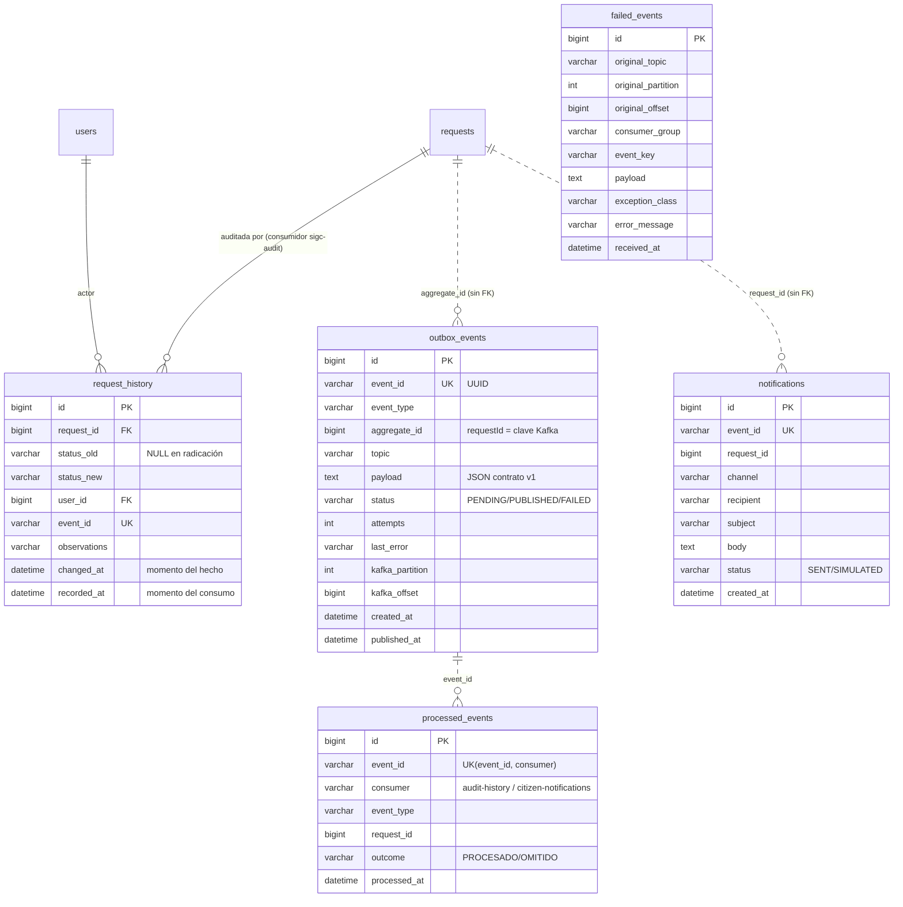

# Modelo de datos

Este modelo se ajustó en la Entrega 2 a partir del dump real de la base
de datos del backend actual (`sigcapi.sql`, incluido en esta entrega).
Esquema `sigcapi` en MariaDB 10.4.

## Tablas existentes en el backend actual

- **users**: `id, full_name, email, document, password, rol
  (ADMIN/CONSULTOR), status (ACTIVO/BLOQUEADO/INACTIVO),
  failed_attempts, lock_until, created_at, updated_at`. No tiene
  columnas `city` ni `phone` (a diferencia de lo propuesto en la
  Entrega 1).
- **requests**: `id, title, description, full_name, email, document,
  city, phone, type (PETICIÓN/QUEJA/RECLAMO), status
  (CREADO/PENDIENTE/CERRADO), created_at`. No tiene columna
  `user_id`; la relación con el ciudadano se hace por coincidencia
  del campo `document` (índice `idx_user_document`), no por llave
  foránea.
- **documents**: `id, request_id (FK -> requests.id), file_name,
  file_path, created_at`.
- **sesiones**: `id, full_name, created_at, closure_at`. **No tiene
  columna `request_id`**: hoy una sesión de chatbot no queda
  vinculada a una solicitud PQR, a diferencia de lo descrito en RF-12
  de la Entrega 1.
- **chats**: `id, sesion_id (FK -> sesiones.id), type
  (USUARIO/ASESORIA), mensaje, created_at`. La tabla existe, pero el
  Postman collection actual no expone endpoints para consultarla o
  escribirla directamente (se administra, previsiblemente, dentro del
  flujo interno de `/sessions`).

## Tabla nueva propuesta en esta entrega

- **request_history**: `id, request_id (FK -> requests.id),
  previous_status, new_status, actor, event_timestamp`. Aún no existe
  en `sigcapi.sql`; se propone como destino del consumidor Kafka
  (`@KafkaListener`) descrito en `docs/kafka.md`.

Ver diagrama: `modelo-datos.png`. Las relaciones marcadas en rojo en
el diagrama son brechas detectadas frente al alcance funcional
definido en la Entrega 1 (ver `docs/decisiones-pendientes.md`).

## Actualización — Entrega 2, segundo periodo (Kafka)

Las tablas siguientes las crea JPA (`ddl-auto=update`) y forman parte del flujo orientado a eventos.

| Tabla | Quién escribe | Propósito |
|---|---|---|
| `outbox_events` | `RequestServiceImpl` (vía `OutboxRequestEventPublisher`) en la misma transacción; `OutboxRelay` actualiza el estado | Publicación confiable (Transactional Outbox) |
| `request_history` | **Solo** el consumidor `sigc-audit` | Auditoría de la PQR (ya no se escribe dentro de la petición HTTP) |
| `notifications` | Consumidor `sigc-notifications` | Evidencia de cada notificación al ciudadano |
| `processed_events` | Ambos consumidores de negocio | Idempotencia (`UNIQUE(event_id, consumer)`) |
| `failed_events` | Consumidor `sigc-dlt` | Mensajes del Dead Letter Topic para revisión |

Cambios en `request_history` frente a la entrega anterior: `status_old` admite `NULL` (radicación),
se agregan `event_id` (único), `observations` y `recorded_at`, y `changed_at` toma el `timestamp`
del evento. Si se conserva un volumen de MariaDB de la entrega anterior, ejecute
`docker compose down -v` una vez para que JPA cree el esquema nuevo (Hibernate `update` no relaja
restricciones `NOT NULL` existentes).
